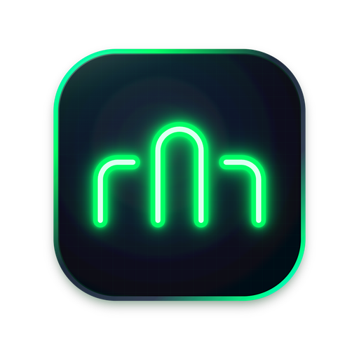

<p align="center">
  
</p>

<h1 align="center">fuxx</h1>

<p align="center">
  <strong>Your not-so-friendly neighborhood CLI.</strong><br>
  A native, GPU-fast terminal for people who run AI coding agents and refuse to babysit them.
</p>

<p align="center">
  <a href="https://github.com/fitzfitz/fuxx-cli/releases/latest"></a>
  
  
  
  
</p>

---

## So what is it?

You've got three agents going. One is refactoring auth, one is writing tests, one is "just looking around".
You flip between windows like a nervous parent at a playground. Is it done? Is it stuck? Is it asking you
something *right now*?

**fuxx** is a real terminal built for exactly that. Every workspace shows what its agent is doing (working,
waiting for you, done), pings you when it needs a human, and otherwise leaves you alone. The mascot is `╭∩╮`.
That's the whole attitude: it gets out of your way, and it's not here to make friends.

Current version: **0.9.0**. macOS 11 or newer, Apple Silicon and Intel.

---

## Install it (on your Mac, or any other Mac)

1. **Download** `fuxx-<version>.zip` from the [latest release](https://github.com/fitzfitz/fuxx-cli/releases/latest).
2. **Unzip** it (double-click) and drag **`fuxx.app`** into **Applications**.
3. **Open it once the macOS way.** fuxx isn't signed with an Apple Developer ID yet, so the first launch gets
   blocked with a "can't be opened" warning. That's expected:
   - open fuxx (it gets blocked, click **Done**),
   - go to **System Settings → Privacy & Security**, scroll down to the message about fuxx,
   - click **Open Anyway**, then **Open** (and your password if asked).

   You only do this once per Mac.
4. **That's it.** From now on fuxx updates itself: when a new version is out, a blue **Update Available** button shows
   up in the sidebar. One click downloads it, checks it, and reopens fuxx. Or use **fuxx → Check for Updates…**.

> Prefer the terminal? After step 2, `xattr -dr com.apple.quarantine /Applications/fuxx.app` clears the "downloaded
> from the internet" flag so the warning never appears. Only do that for a copy you downloaded from the release page
> above.

**Moving to a new Mac?** Install as above, then copy `~/.config/fuxx/` (your settings and themes) over. Your
workspaces live in `~/Library/Application Support/fuxx/sessions.json` if you want those too.

---

## What it does

### 🧠 Knows what your agents are up to
- Every terminal gets a **live status**: working, waiting for you, done, or idle. You see it as a dot on its avatar in
  the sidebar, on its tab, in the status bar, and even as the **cursor's colour**.
- A waiting agent's **question shows right in the sidebar**, with an **Open** button that takes you straight to it.
- **Desktop notifications** when a background agent finishes or needs you. Never about the one you're already looking at.
- **⇧⌘U** jumps to whoever has waited longest for you. Press it again for the next one.

### 🗂 Workspaces, panes, tabs, and a sidebar that looks good doing it
- A **workspace** is a layout of **split panes** (⌘D / ⇧⌘D); every pane has its own **tab bar** of terminals, web pages
  and files.
- The sidebar gives each workspace a coloured **avatar** and a line saying what it's doing (or where it is).
  Workspaces from the same folder get grouped into a **card**, with the git branch on its header.
- **Drag anything anywhere**: reorder workspaces, move them in and out of groups, drag tabs between panes or onto
  another workspace.
- **⌘K** searches everything (actions, workspaces, files, settings). **⌘P** jumps between workspaces.
- **Pin** what matters, give workspaces a colour, rename with a real text box (yes, the caret moves).

### 📁 Your repo, right there
- **⌥⌘\\** opens the right sidebar: **Files**, **Changes** and **Activity**.
- Single-click a file for a quick **preview tab** (italic, replaced by the next click); double-click to keep it.
- Read-only file tabs with syntax colours, change bars, **⌘F**, and a **File ↔ Diff** switch. They update live while
  your agent edits. fuxx never changes your files.
- Double-click a folder and your terminal `cd`s there. `cd` in a terminal and the sidebar knows instantly.
- Click the **branch** on a sidebar group (or ⌘K → Switch branch…) to change branches, with a confirm step and
  conflict warnings.

### 🌐 A browser in a pane
- Open web pages as tabs right next to your terminals (⇧⌘B). Click a port like `:3000` in the status bar to open your
  dev server.
- Agents can drive the browser too (`fuxx browser open|click|fill|snapshot…`, or the MCP tools).

### 🔌 SSH, done properly
- **⇧⌘S** picks a host from your `~/.ssh/config`. It runs your own `ssh`, so keys, jump hosts and 2FA just work.
  Optionally keep it alive in tmux on the host.

### ✨ The fun stuff
- **Command blocks** (zsh): every command gets a slim bar (red when it failed). Hover it to copy the command, copy
  its output, or rerun it. ⇧⌘↑ / ⇧⌘↓ jump between commands.
- **A cursor with personality**: it glides, breathes instead of blinking, and can leave a **comet trail** or throw
  **sparks** as you type (Settings → Appearance → Cursor).
- **Key sounds**: give Enter and Ctrl+C a sound (a file, or a link to an mp3), each with its own On/Off. Click-clack.
- **Themes**: Catppuccin, Dracula, Gruvbox, TokyoNight and more, with a live preview. Light themes look good too.

### 🧰 Grown-up stuff
- **Restore**: your workspaces, panes, tabs and pins come back after a restart.
- **Keep running after quit** (opt-in): sessions live on in a tiny background service, and reopening brings them back live.
- **Agent presets**: one key to start `claude`, `codex` and friends where you want them.
- **Scriptable**: the `fuxx` command and an **MCP server**, so agents can drive fuxx (below).

---

## Script it

Inside any fuxx terminal, the `fuxx` command talks to the app:

```sh
fuxx ls                                   # every terminal: id, status, name…
fuxx new --preset claude --split right    # start an agent next to you (prints its id, e.g. s4)
fuxx wait s4                              # block until it needs you (or --for done|exit)
fuxx question s4                          # what's it asking?
fuxx answer s4 "yes"                      # tell it
fuxx events                               # live stream of everything that happens
fuxx note "building" · fuxx progress 40   # show a note / progress bar on your own row
```

Let your agents drive fuxx: `claude mcp add fuxx -- fuxx mcp`. `fuxx help` lists every command.

---

## Make it yours

Settings live in **⌘,** (General, Appearance, Sessions, Browser, Sound) and in `~/.config/fuxx/config`, one
`key = value` per line:

```ini
theme = TokyoNight
font-size = 14
cursor-fun = sparks
session-restore = agents        # off | layout | agents
persistent-sessions = on        # keep sessions running after quit
sound-enter = /System/Library/Sounds/Tink.aiff
```

---

## Handy keys

| Keys | What happens |
| :--- | :--- |
| ⌘N / ⌘T | New workspace / new terminal tab |
| ⌘D / ⇧⌘D | Split right / split down |
| ⌘K / ⌘P | Search everything / jump to a workspace |
| ⇧⌘U | Go to the agent that needs you |
| ⌘1 … ⌘9 | Pick a workspace |
| ⌘\\ / ⌥⌘\\ | Hide the sidebar / open the right sidebar |
| ⇧⌘S / ⇧⌘B | SSH session / browser tab |
| ⌘= / ⌘− / ⌘0 | Bigger / smaller / actual font size |

---

## Under the hood

Rust · [GPUI](https://github.com/zed-industries/zed) (the UI framework behind Zed) · `alacritty_terminal` ·
`portable-pty`. The `docs/` folder is an Obsidian vault with the vision, the roadmap and a note for every milestone.
[`STRUCTURE.md`](STRUCTURE.md) maps the repo.

Building from source: `cargo run` (Rust stable, macOS). Screenshots of every screen in a dark and a light theme:
`cargo run --features ui-shots -- __ui-shots` (PNGs land in `target/ui-shots/`).

## Status

Young, moving fast, and used daily. macOS first. Things will change, mostly for the better.

## History

This repo started life as a tiny Rust CLI that ran one agent and pinged you when it finished. It grew up into this
terminal. The old code is in the git history, its docs under `docs/90-Archive-v1-CLI-Wrapper/`.
